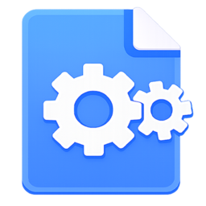
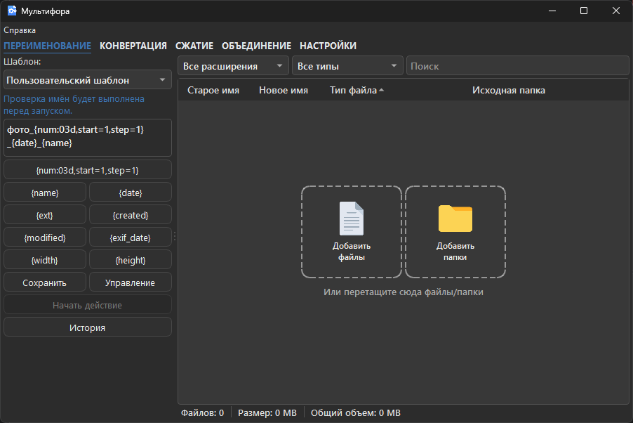

<table>
  <tr>
    <td width="175" align="center" valign="middle">
      
    </td>
    <td valign="middle">
      <h1>Мультифора</h1>
      <p>Windows-приложение для пакетной работы с файлами.</p>
      <p>
        <a href="https://vsemirka200.github.io/multifora/"></a>
        <a href="https://github.com/VseMirka200/multifora/releases/latest"></a>
        <a href="https://vsemirka200.github.io/multifora/"></a>
        <a href="https://github.com/VseMirka200/multifora/issues/new/choose"></a>
      </p>
    </td>
  </tr>
</table>

Мультифора помогает выполнять повторяющиеся операции над большим количеством файлов из одного окна: переименовывать, конвертировать, объединять и сжимать. Приложение рассчитано на Windows и работает локально.

## Возможности

- Пакетное переименование: шаблоны, нумерация, дата, замена текста и предварительный просмотр результата.
- Конвертация документов и изображений в поддерживаемые форматы.
- Объединение PDF и DOCX в один файл с заданным порядком.
- Сжатие PDF и изображений с выбором параметров качества.
- Добавление файлов перетаскиванием, через окно выбора и из контекстного меню Проводника Windows.
- Журнал операций и сохранение настроек интерфейса.

<p align="center">
  
</p>

## Установка

Для большинства пользователей достаточно готовой сборки:

1. Откройте [последний релиз](https://github.com/VseMirka200/multifora/releases/latest).
2. Скачайте `Multifora-Setup-<версия>.exe`.
3. Запустите установщик и следуйте его шагам.

Также доступна переносная ZIP-версия. Распакуйте архив целиком в постоянную папку и запускайте `Multifora.exe` — не запускайте приложение прямо из архива.

Подробности, включая проверку контрольной суммы и обновление, есть в [руководстве по установке](https://vsemirka200.github.io/multifora/ru/guide/install.html).

## Быстрый старт

1. Добавьте файлы в окно приложения.
2. Выберите операцию: переименование, конвертацию, объединение или сжатие.
3. Настройте параметры и проверьте предварительный результат, если он доступен.
4. Укажите папку вывода и запустите обработку.

Для важных данных сначала обработайте копии нескольких файлов. Полное пошаговое описание доступно в [быстром старте](https://vsemirka200.github.io/multifora/ru/guide/quick-start.html).

## Поддерживаемые задачи

| Задача | Где узнать больше |
| --- | --- |
| Переименовать множество файлов по правилу | [Переименование](https://vsemirka200.github.io/multifora/ru/guide/rename.html) |
| Изменить формат документа или изображения | [Конвертация](https://vsemirka200.github.io/multifora/ru/guide/conversion.html) |
| Собрать несколько PDF или DOCX | [Объединение](https://vsemirka200.github.io/multifora/ru/guide/optimize.html#объединение-документов) |
| Уменьшить размер PDF или изображения | [Сжатие](https://vsemirka200.github.io/multifora/ru/guide/optimize.html#сжатие-файлов) |

## Разработка

Требуется Python 3.11 или новее и Windows. Создайте окружение, установите зависимости и запустите приложение:

```powershell
git clone https://github.com/VseMirka200/multifora.git
cd multifora
py -3.11 -m venv .venv
.\.venv\Scripts\python.exe -m pip install --upgrade pip
.\.venv\Scripts\python.exe -m pip install -r requirements-dev.txt
.\.venv\Scripts\python.exe multifora_start.py
```

Проверки проекта запускаются командой:

```powershell
.\.venv\Scripts\python.exe -m pytest
.\.venv\Scripts\python.exe -m ruff check .
```

Перед предложением изменений прочитайте [правила участия](docs/project/CONTRIBUTING.md), [Кодекс поведения](docs/project/CODE_OF_CONDUCT.md) и [политику безопасности](docs/project/SECURITY.md).

## Документы проекта

| Документ | Назначение |
| --- | --- |
| [Правила участия](docs/project/CONTRIBUTING.md) | Как подготовить и проверить Pull Request. |
| [Кодекс поведения](docs/project/CODE_OF_CONDUCT.md) | Правила общения в пространствах проекта. |
| [Политика безопасности](docs/project/SECURITY.md) | Как конфиденциально сообщить об уязвимости. |
| [Поддержка](docs/project/SUPPORT.md) | Где задать вопрос или сообщить о проблеме. |
| [Выпуск версии](docs/project/RELEASING.md) | Как создать проверенный Windows-релиз. |
| [Журнал изменений](docs/project/CHANGELOG.md) | Где отслеживать изменения версий. |
| [Лицензия MIT](LICENSE) | Условия использования и вкладов. |

## Помощь и обратная связь

- Ответы на распространённые вопросы: [устранение неполадок](https://vsemirka200.github.io/multifora/ru/reference/troubleshooting.html).
- Ошибка или предложение: [создать issue](https://github.com/VseMirka200/multifora/issues/new/choose).
- Вопросы о параметрах программы: [настройки](https://vsemirka200.github.io/multifora/ru/reference/settings.html).

## Лицензия

Проект распространяется по [лицензии MIT](LICENSE).
