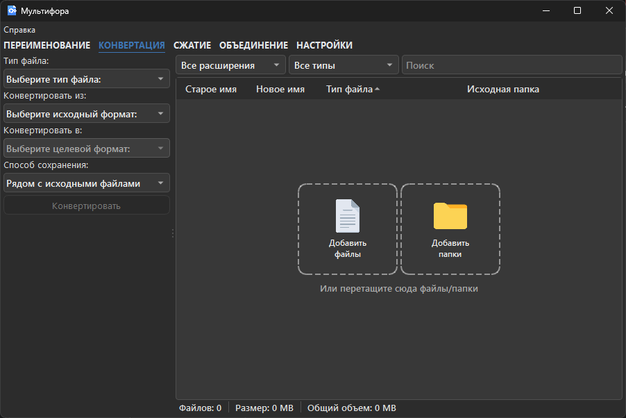
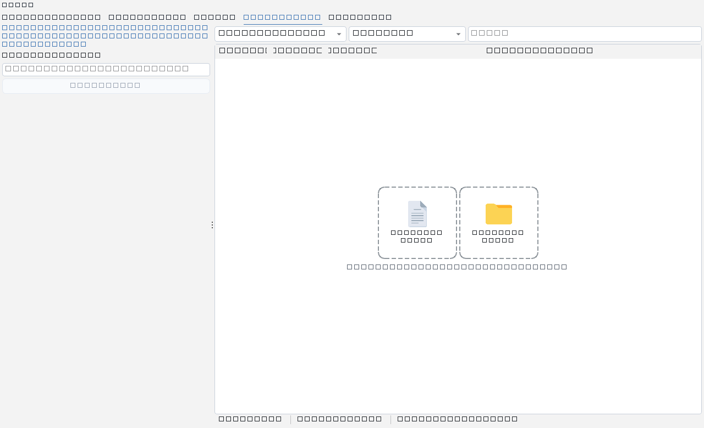
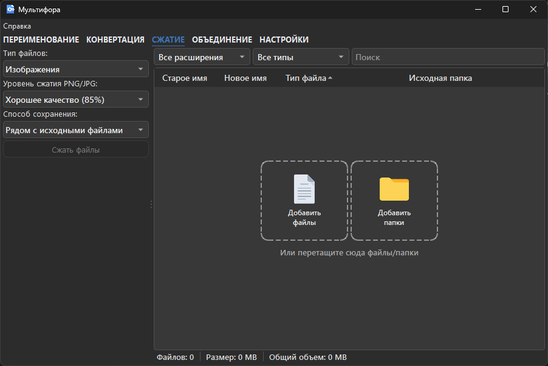

  

    

      БЕСПЛАТНО · ОТКРЫТЫЙ КОД · WINDOWS
      <h1>Все операции с файлами. В одном месте.</h1>
      
Переименовывайте, конвертируйте, объединяйте и сжимайте файлы — удобно, быстро и без загрузки документов в облако.

      

        <a class="mf-button mf-button--light" href="https://github.com/VseMirka200/multifora/releases">Посмотреть релизы ↗</a>
        <a class="mf-button mf-button--outline" href="quick-start/">Как пользоваться →</a>
      

      
Готовые релизы пока не опубликованы. <a href="https://github.com/VseMirka200/multifora">Исходный код открыт на GitHub</a>.

    

    

      

        
● ● ●Мультифора · Конвертация

        
      

      Ваши файлы остаются на компьютере
    

  

  
<strong>Windows 10/11</strong>64-разрядная система

  
<strong>Бесплатно</strong>Без подписки

  
<strong>Открытый код</strong>Лицензия MIT

  
<strong>Локально</strong>Без облачной загрузки

<section class="mf-section" id="features">
  

    ВОЗМОЖНОСТИ
    <h2>Меньше ручной работы с файлами</h2>
    
Четыре привычные задачи объединены в одном понятном приложении для Windows.

  

  

    <article class="mf-feature">
      01
      <h3>Пакетное переименование</h3>
      
Шаблоны, нумерация, даты, EXIF и замена текста. Предварительный просмотр помогает проверить имена до применения.

      <a href="rename/">Узнать больше →</a>
    </article>
    <article class="mf-feature">
      02
      <h3>Конвертация файлов</h3>
      
Преобразование документов и изображений с выбором форматов и папки сохранения. Доступные варианты зависят от исходного файла.

      <a href="conversion/">Поддерживаемые форматы →</a>
    </article>
    <article class="mf-feature">
      03
      <h3>Объединение документов</h3>
      
Собирайте PDF с PDF или DOCX с DOCX в порядке, который сами задали в очереди.

      <a href="optimize/">Как объединять →</a>
    </article>
    <article class="mf-feature">
      04
      <h3>Сжатие без лишних шагов</h3>
      
Уменьшайте размер изображений и PDF, контролируя параметры качества и место сохранения результата.

      <a href="optimize/">Настройки сжатия →</a>
    </article>
  

</section>

<section class="mf-section mf-section--gallery" id="interface">
  

    ИНТЕРФЕЙС
    <h2>Всё нужное — перед глазами</h2>
    
Настройте операцию, проверьте очередь и запустите обработку. Вот как выглядит приложение.

  

  

    <figure><figcaption><strong>Переименование</strong>Проверка имён и шаблонов</figcaption></figure>
    <figure><figcaption><strong>Конвертация</strong>Форматы и путь сохранения</figcaption></figure>
    <figure><figcaption><strong>Объединение</strong>Порядок файлов в очереди</figcaption></figure>
    <figure><figcaption><strong>Сжатие</strong>Управление качеством результата</figcaption></figure>
  

</section>

<section class="mf-section" id="how-it-works">
  

    БЫСТРЫЙ СТАРТ
    <h2>Три шага до результата</h2>
  

  

    
1<h3>Добавьте файлы</h3>
Перетащите документы в окно или выберите их через диалог и Проводник.

    
2<h3>Выберите действие</h3>
Настройте переименование, конвертацию, объединение или сжатие.

    
3<h3>Проверьте результат</h3>
Просмотрите параметры и обработайте очередь. Перед заменой исходников сохраните копии.

  

  
<a href="quick-start/">Пошаговая инструкция →</a>

</section>

<section class="mf-section mf-section--split" id="downloads">
  

    СКАЧИВАНИЕ И УСТАНОВКА
    <h2>Готово к работе на Windows</h2>
    
После публикации версии здесь будут доступны установщик и ZIP-архив portable-сборки. Обе поставляются через GitHub Releases с контрольными суммами SHA-256.

    
<strong>Сейчас опубликованных релизов нет.</strong> Не скачивайте «готовые сборки» с неизвестных сайтов.

    

      <a class="mf-button mf-button--primary" href="https://github.com/VseMirka200/multifora/releases">Страница выпусков ↗</a>
      <a class="mf-button mf-button--secondary" href="install/">Инструкция по установке →</a>
    

  

  <aside class="mf-requirements">
    <h3>Что понадобится</h3>
    <ul>
      <li>Windows 10 или 11, 64-bit.</li>
      <li>Для исходного кода — Python 3.11+.</li>
      <li>Microsoft Word — только для некоторых преобразований офисных документов.</li>
      <li>Рабочие файлы обрабатываются локально, без загрузки на сайт.</li>
    </ul>
  </aside>
</section>

<section class="mf-section mf-section--faq" id="faq">
  

    ОТВЕТЫ НА ВОПРОСЫ
    <h2>Полезно знать</h2>
  

  

    

Нужно ли загружать файлы на сайт?

Нет. Это сайт приложения и документации, а не онлайн-конвертер. Все операции с рабочими файлами выполняются локально в Мультифоре на Windows.

    

Можно ли заменить исходные файлы?

В некоторых режимах — да. Перед применением настроек проверьте предварительный результат и создайте резервную копию исходников.

    

Что делать, если формат недоступен?

Откройте <a href="conversion/">список поддерживаемых форматов</a>: некоторые преобразования требуют дополнительного программного обеспечения, например Microsoft Word.

  

</section>

  
<h2>Одна программа для повседневных задач с файлами.</h2>
Изучите возможности Мультифоры и начните с короткой инструкции.

  

    <a class="mf-button mf-button--light" href="quick-start/">Открыть руководство →</a>
    <a class="mf-button mf-button--outline" href="https://github.com/VseMirka200/multifora">Исходный код ↗</a>
  

Мультифора — бесплатный проект с открытым исходным кодом под лицензией <a href="https://github.com/VseMirka200/multifora/blob/main/LICENSE">MIT</a>. <a href="en/">English version</a> · <a href="SECURITY/">Безопасность</a> · <a href="troubleshooting/">Помощь</a>

